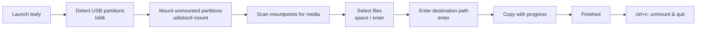

# 🌿 Leafy Documentation

Leafy is a small, Linux-only terminal application (TUI) written in Go. It moves media files (audio and video) from
external USB drives, such as action cameras, external microphones, SD-card readers and thumb drives, to a folder on
your computer.

This directory holds the project's technical and user documentation. Every statement here comes from the source code
in this repository.

## Contents

| Document                                                 | Audience     | What it covers                                                             |
|----------------------------------------------------------|--------------|----------------------------------------------------------------------------|
| [Getting Started](getting-started.md)                    | Users        | Requirements, installation, first run                                      |
| [User Workflow](user-workflow.md)                        | Users        | Step-by-step usage, screens, key bindings, what happens on exit            |
| [Architecture](architecture.md)                          | Contributors | Package layout, Bubble Tea model, state machine, message flow              |
| [Features](features/README.md)                           | Everyone     | Detailed description of every feature                                      |
| ↳ [Device Management](features/device-management.md)     |              | USB detection (`lsblk`), mounting/unmounting (`udisksctl`)                 |
| ↳ [Media Discovery](features/media-discovery.md)         |              | Recursive scanning and supported file formats                              |
| ↳ [File Transfer](features/file-transfer.md)             |              | Safe copying, progress reporting, permission and timestamp preservation    |
| ↳ [Terminal UI](features/terminal-ui.md)                 |              | Screens, rendering, key handling, styling                                  |
| ↳ [Versioning](features/versioning.md)                   |              | How the displayed version string is resolved                               |
| ↳ [Configuration & Logging](features/config-and-logging.md) |           | Config defaults and the JSON file logger (not yet wired in)                |
| [Development Guide](development.md)                      | Contributors | Local setup, build, run, formatting, linting, security checks              |
| [CI/CD & Releases](ci-cd-and-releases.md)                | Maintainers  | GitHub Actions pipelines and the release process                           |
| [Known Limitations & Roadmap](known-limitations.md)      | Everyone     | Current caveats, known bugs, unused code, TODOs                            |

## Feature summary

- **Automatic USB discovery**: finds USB disks and their partitions with `lsblk`.
- **Automatic mounting**: mounts any unmounted USB partitions with `udisksctl`, without root.
- **Media detection**: recursively scans every mounted USB partition for audio (`.mp3`, `.wav`, `.flac`) and
  video (`.mp4`, `.mkv`, `.avi`, `.mov`, `.wmv`, `.flv`, `.webm`) files. Extensions are matched case-insensitively.
- **Interactive selection**: a keyboard-driven checklist showing each file's name and human-readable size.
- **Destination prompt**: a text input for the target directory, with `~` expansion.
- **Safe transfer**: writes to a `.tmp` file first, `fsync`s it, then renames it atomically. Permissions and
  access/modification times are preserved.
- **Live progress**: shows copied bytes and percentage for each file, updated every 150 ms.
- **Clean exit**: `ctrl+c` unmounts the USB partitions Leafy detected. Quitting is blocked while a copy is running.

## High-level workflow

