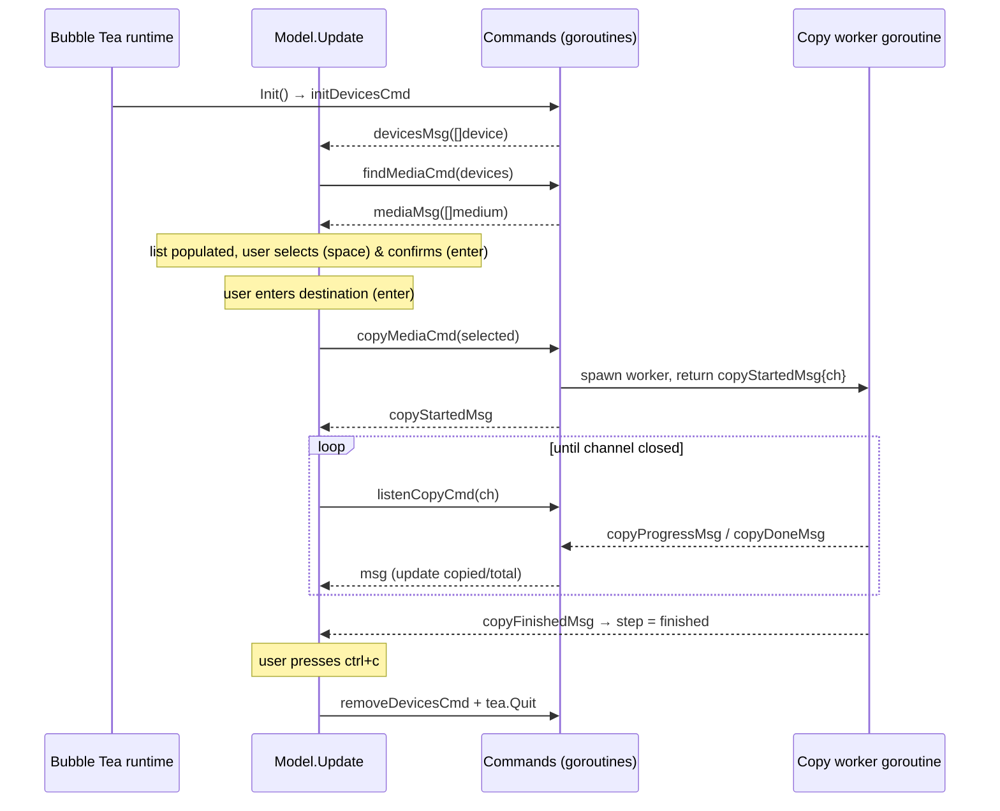

# Architecture

Leafy is a single Go module (`github.com/nightails/leafy`) built on the
[Bubble Tea](https://github.com/charmbracelet/bubbletea) framework, which follows the Elm architecture
(Model → Update → View). All blocking work, such as shelling out to system tools, walking directories and copying
files, runs inside Bubble Tea **commands** (`tea.Cmd`). The UI stays responsive while that work runs.

## Repository layout

```
leafy/
├── main.go                    # Entry point: resolves version, starts the Bubble Tea program
├── app/
│   └── tui/                   # Presentation layer (Bubble Tea model)
│       ├── tui.go             # Model, Init, Update (state machine), View
│       ├── cmd.go             # Async commands: detect/mount, scan, copy, unmount
│       ├── msg.go             # Message types exchanged between commands and Update
│       ├── state.go           # In-memory app state (devices, media)
│       ├── item.go            # list.Item + custom list delegate for the media checklist
│       └── format.go          # Supported extensions, size formatting, "~" expansion
├── internal/                  # Domain/infrastructure packages (not importable externally)
│   ├── device/                # USB discovery (lsblk) and mount control (udisksctl)
│   ├── file/                  # Media scanning and progress-reporting safe copy
│   ├── style/                 # Lip Gloss styles, spinner + min-duration helpers, delays
│   ├── config/                # Default configuration (log path) – not yet used
│   └── log/                   # slog JSON file logger – not yet used
├── assets/                    # ASCII art logo and an (empty) TUI layout placeholder
├── scripts/buildrelease.sh    # Cross-compiles release binaries + checksums
└── .github/workflows/         # ci.yml (tests, gosec, fmt, staticcheck), cd.yml (release)
```

### Dependency graph

```mermaid
flowchart TD
    main[main.go] --> tui[app/tui]
    tui --> device[internal/device]
    tui --> file[internal/file]
    tui --> style[internal/style]
    log[internal/log] --> config[internal/config]
    device -->|exec| lsblk[(lsblk)]
    device -->|exec| udisksctl[(udisksctl)]
    file -->|syscalls| unix[(golang.org/x/sys/unix)]
    tui --> bubbletea[(bubbletea / bubbles / lipgloss)]
```

`internal/log` and `internal/config` are not reachable from `main` yet.

## The Bubble Tea model

`tui.Model` (in `app/tui/tui.go`) holds the whole UI state:

| Field        | Type                 | Purpose                                                    |
|--------------|----------------------|------------------------------------------------------------|
| `version`    | `string`             | Shown in the header (`Leafy <version>`)                    |
| `state`      | `state`              | `devices []device` (detected/mounted) and `media []medium` (selected) |
| `currStep`   | `step`               | Current workflow step (see below)                          |
| `mediaList`  | `list.Model`         | Bubbles list rendering the media checklist                 |
| `destInput`  | `textinput.Model`    | Bubbles text input for the destination path                |
| `copyEvents` | `<-chan tea.Msg`     | Channel streaming copy progress from the worker goroutine  |
| `err`        | `error`              | First fatal error; when set, the view shows only the error |

### Workflow steps (state machine)

```go
const (
    media = iota   // select files
    destination    // type destination path
    copying        // transfer in progress
    finished       // transfer done
)
```

The step only moves forward (`currStep++` or a direct assignment to `finished`). `View()` renders cumulatively. Each
step shows its own section plus the sections of all earlier steps (`if m.currStep >= ...`).

### Key handling (`Update`, `tea.KeyMsg`)

| Key                | Behaviour                                                                                          |
|--------------------|----------------------------------------------------------------------------------------------------|
| `ctrl+c`           | Ignored in `copying`; otherwise `tea.Batch(removeDevicesCmd(devices), tea.Quit)`                    |
| `" "` (space)      | Toggles the `selected` flag of the highlighted `mediumItem` (in **any** step)                       |
| `enter` / `return` | `media`: collect selected items into `state.media`, go to `destination`, focus input. `destination`: expand `~`, set each `medium.dest = filepath.Join(dest, name)`, go to `copying`, start `copyMediaCmd` |
| anything else      | Sent to `mediaList` (step `media`) or `destInput` (step `destination`) if no error is set           |

## Commands and messages

All side effects live in `app/tui/cmd.go`. Each command returns a message, defined in `app/tui/msg.go`, which
`Update` handles.

| Command                    | Does                                                                 | Emits                                           |
|----------------------------|----------------------------------------------------------------------|-------------------------------------------------|
| `initDevicesCmd()`         | `device.FindUSBDevices()`, then `device.MountDevice()` for unmounted ones | `devicesMsg` or `errMsg`                   |
| `findMediaCmd(devices)`    | `file.GetFiles(mountpoints, formats)`                                | `mediaMsg`, `errMsg`, or `nil` (nothing found)  |
| `copyMediaCmd(media)`      | Starts a goroutine copying files sequentially with `file.CopyWithProgress` | `copyStartedMsg{Ch}`                      |
| `listenCopyCmd(ch)`        | Blocks on the channel for the next copy event                        | `copyProgressMsg`, `copyDoneMsg`, `copyErrorMsg`, `copyFinishedMsg` |
| `removeDevicesCmd(devices)`| `device.UnmountDevice()` for each device                             | `nil` or `errMsg`                               |

### End-to-end message flow



### Copy progress pipeline

The copy runs on a goroutine. It talks to Bubble Tea through an **unbuffered channel** and a self-rescheduling
listener command:

1. `copyMediaCmd` creates `ch` and starts the worker. It immediately returns `copyStartedMsg{ch}`.
2. `Update` stores `ch` in `m.copyEvents` and returns `listenCopyCmd(ch)`.
3. Every progress, done, or finished message makes `Update` return `listenCopyCmd(ch)` again. This pulls the next
   event, so the worker cannot run ahead of the UI (back-pressure).
4. Inside `file.CopyWithProgress`, a ticker goroutine samples an `atomic.Int64` byte counter every 150 ms. It invokes
   the progress callback, which sends `copyProgressMsg{Index, Copied, Total}`.
5. After the last file, the worker sends `copyFinishedMsg{}` and closes the channel. A closed channel also maps to
   `copyFinishedMsg`.
6. On failure, the worker sends `copyErrorMsg` and stops. `Update` stores the error and stops listening.

## Domain packages

| Package           | Public API                                                                                  | Details |
|-------------------|---------------------------------------------------------------------------------------------|---------|
| `internal/device` | `USBDevice`, `FindUSBDevices`, `MountDevice`, `UnmountDevice`, `PowerOffDevice`              | [Device Management](features/device-management.md) |
| `internal/file`   | `File`, `GetFiles`, `CopyWithProgress`, `ProgressFn`                                         | [Media Discovery](features/media-discovery.md), [File Transfer](features/file-transfer.md) |
| `internal/style`  | `HeaderStyle`, `TextStyle`, `HelpTextStyle`, `LoadDelay`, `QuitDelay`, `NewLineSpinner`, `MinDuration` | [Terminal UI](features/terminal-ui.md) |
| `internal/config` | `Config{LogPath}`, `Default()`                                                               | [Configuration & Logging](features/config-and-logging.md) |
| `internal/log`    | `InitializeLogger(cfg) (*slog.Logger, CloseFunc, error)`                                     | [Configuration & Logging](features/config-and-logging.md) |

## Design notes

- **No root required**: mounting goes through UDisks2 (`udisksctl`), which uses polkit to authorise desktop users.
- **Locale-independent parsing**: `udisksctl` runs with `LC_ALL=C`, so its English output can be parsed with regexes.
- **Command-injection hardening**: device paths are checked against `^/dev/[A-Za-z0-9._/-]+$` before they reach
  `exec.Command`. The matching `#nosec G204` annotations keep `gosec` quiet.
- **Path-traversal hardening**: copies use `os.OpenRoot` / `os.Root` for both source and destination. The source must
  sit strictly inside its scan root.
- **Crash-safe writes**: data goes to `<name>.tmp`, is `fsync`'d, then renamed into place.
