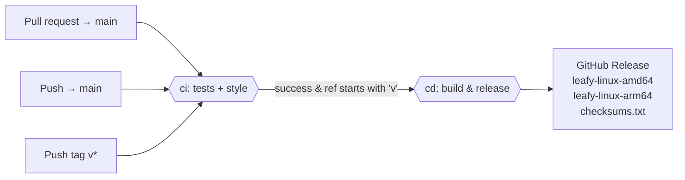

# CI/CD & Releases

Two GitHub Actions workflows live in `.github/workflows/`.



## `ci` (`ci.yml`)

**Triggers:** pull requests targeting `main`, pushes to `main`, and pushes of tags matching `v*`.

| Job     | Steps                                                                                       |
|---------|---------------------------------------------------------------------------------------------|
| `tests` | checkout → Go 1.26.0 → install `gosec` → `go test -cover ./...` → `gosec ./...`              |
| `style` | checkout → Go 1.26.0 → install `staticcheck` → `test -z "$(go fmt ./...)"` → `staticcheck ./...` |

## `cd` (`cd.yml`)

**Trigger:** `workflow_run` on completion of `ci`.

**Condition:** the CI run succeeded **and** `github.event.workflow_run.head_branch` starts with `v`. For tag pushes,
that is the tag name.

**Permissions:** `contents: write`, needed to create releases.

Steps:
1. Check out the tag (`ref: head_branch`) with full history (`fetch-depth: 0`), so `git describe` can see tags.
2. Set up Go 1.26.0.
3. Run `bash scripts/buildrelease.sh`.
4. Publish a GitHub Release for the tag with `softprops/action-gh-release@v3`, uploading `dist/*`.

## `scripts/buildrelease.sh`

1. Resolve `VERSION` (see [Versioning](features/versioning.md)).
2. Delete and recreate `dist/`.
3. For each `GOARCH` in `amd64` and `arm64`, run:
   ```bash
   GOOS=linux GOARCH=$arch CGO_ENABLED=0 \
     go build -trimpath -ldflags="-s -w -X main.version=$VERSION" -o dist/leafy-linux-$arch .
   ```
   The resulting binaries are static (no cgo), stripped (`-s -w`), and reproducible-path (`-trimpath`).
4. Write `dist/checksums.txt` with `sha256sum *`.

## Cutting a release

```bash
git checkout main && git pull
git tag v0.4.0
git push origin v0.4.0
```

The tag push runs `ci`. When it passes, `cd` builds the binaries and publishes the **v0.4.0** release. `go install
github.com/nightails/leafy@latest` also picks up the new tag through the Go module proxy.

> **Note:** a *branch* whose name starts with `v` (for example `v2-refactor`) also passes the `cd` condition after a
> successful CI run. CI only runs for `main` pushes, PRs to `main`, and `v*` tags. A PR from such a branch can
> therefore trigger a release attempt.
