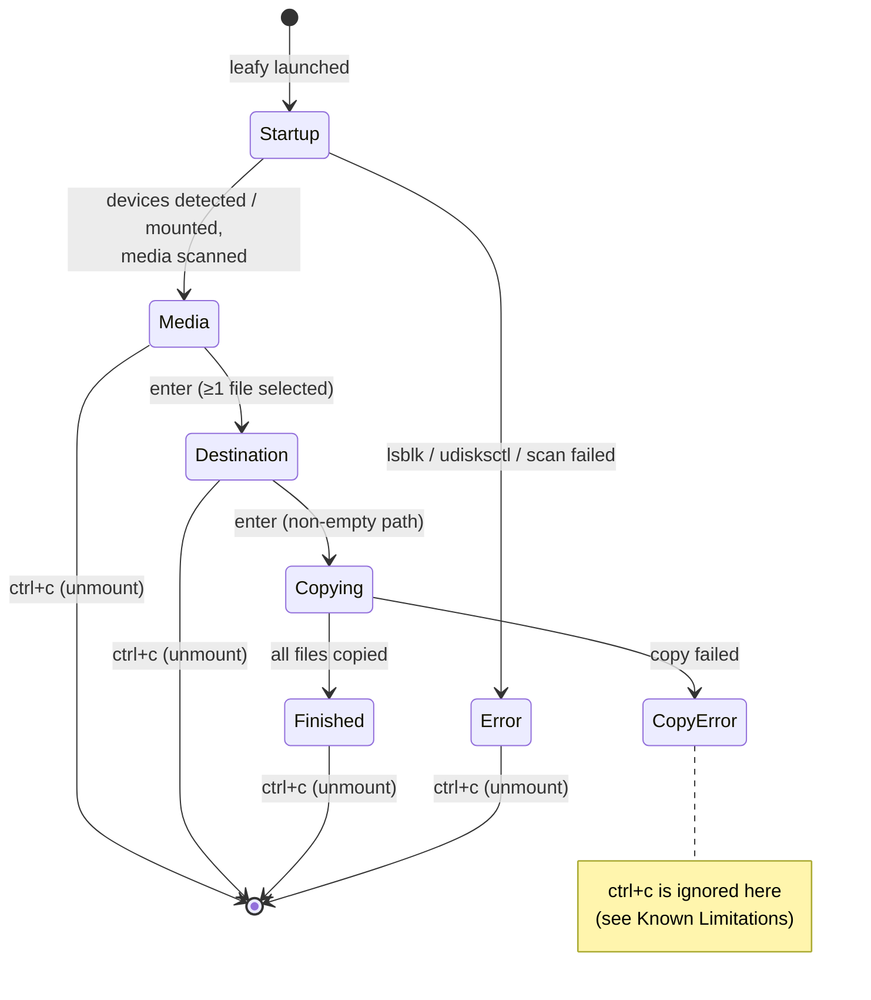

# User Workflow

Leafy walks you through one linear flow. It starts by detecting and mounting devices, then moves through four
interactive steps: **Media selection → Destination → Copying → Finished**. You cannot go back to an earlier step. To
start over, quit with `ctrl+c` and run Leafy again.



## 0. Startup: detect, mount, scan

These steps run automatically in the background as soon as the program starts:

1. **Detect**: `lsblk` lists block devices. Leafy keeps USB disks (`TYPE=disk`, `TRAN=usb`) and their partitions that
   have a filesystem. A USB disk without a partition table but with a filesystem is used directly.
2. **Mount**: every unmounted partition is mounted with `udisksctl mount -b <partition>`, usually under
   `/run/media/$USER/<LABEL>` or `/media/$USER/<LABEL>`. Partitions that are already mounted keep their current
   mountpoint.
3. **Scan**: every mountpoint is walked recursively for supported media files. See
   [Media Discovery](features/media-discovery.md).

If no USB device or no media is found, the list stays empty.

## 1. Media selection

```
+------------+
| Leafy v0.x |
+------------+

Found media:
> [x] GX010001.MP4 (3.92 GB)
  [ ] GX010002.MP4 (1.07 GB)
  [x] REC_0001.WAV (212.34 MB)

[j/k] up/down | [space] select | [enter] confirm | [ctrl+c] quit
```

| Key                  | Action                                            |
|----------------------|---------------------------------------------------|
| `↑` / `k`            | Move cursor up                                    |
| `↓` / `j`            | Move cursor down                                  |
| `home`/`g`, `end`/`G` | Jump to first / last item (Bubbles list defaults) |
| `space`              | Toggle selection of the highlighted file          |
| `enter`              | Confirm the selection and go to the next step     |
| `ctrl+c`             | Unmount devices and quit                          |

- The `>` marker shows the cursor. `[x]` means selected.
- Sizes use decimal (SI) units: 1 KB = 1000 B, 1 MB = 1000 KB, and so on.
- Pressing `enter` with nothing selected does nothing.
- Filtering (`/`) and the list's `q`/`esc` quit keys are disabled.

## 2. Destination

```
Destination Path:
> ~/Videos/2026-11-03-ride
```

- Type the target **directory** and press `enter`.
- Use `~` or `~/...` to refer to your home directory.
- A relative path is resolved against the directory you launched Leafy from.
- Missing directories are created automatically, with permissions `0700`.
- Each file is copied to `<destination>/<original file name>`. The directory structure of the device is **not**
  preserved, and existing files with the same name are **overwritten**.
- An empty path is ignored, so `enter` does nothing.

> ⚠️ Currently the `space` key is captured by the selection handler in every step. You cannot type spaces into the
> destination path. See [Known Limitations](known-limitations.md).

## 3. Copying

```
Copying Progress:
GX010001.MP4 1.20 GB/3.92 GB (31%)
REC_0001.WAV 0 B/212.34 MB (0%)

[copying in progress: quitting disabled]
```

- Files are copied **one after another**, in the order they were listed.
- Progress for the active file refreshes about every 150 ms.
- `ctrl+c` and all other keys are **ignored** while copying, so a transfer cannot be interrupted halfway from the UI.
- If any file fails, copying stops and the error message replaces the screen. Files copied before the failure stay
  at the destination.

## 4. Finished

Once every file is copied, all progress lines read 100%. The help line comes back, and you can press `ctrl+c` to quit.

## Exiting

`ctrl+c` (outside the copying step) runs these steps:

1. Leafy runs `udisksctl unmount -b <partition>` for **every USB partition it detected**. This includes partitions
   that were already mounted before Leafy started.
2. The program quits and restores the terminal.

Unmounting runs alongside the quit command, so an unmount error is not shown. The device may still be mounted
afterwards in that case. Leafy does **not** power off the device; that helper exists in the code but is not used yet.

## Errors

Any error stops the flow and its text replaces the UI body. Examples: `lsblk` failing, `udisksctl` failing to mount, a
scan error, or a copy error. The only way out is `ctrl+c`, which still tries to unmount the devices.

> ⚠️ If the error happens **during copying**, the app stays in the copying step, and quitting is blocked there. In
> that case `ctrl+c` has no effect. You have to close the terminal or kill the process (`kill <pid>` from another
> shell). Then unmount the device yourself, for example with `udisksctl unmount -b /dev/sdX1`.
